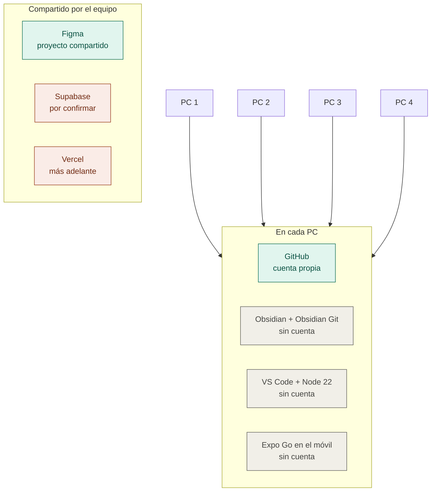
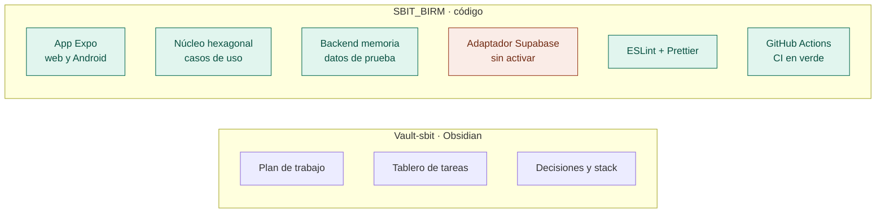
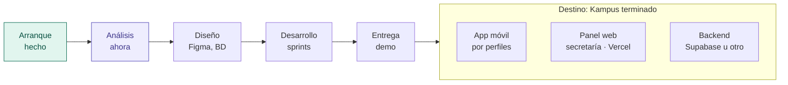

# 🗺️ Esquema del proyecto — Kampus

Volver a [[Inicio]] · Detalle técnico en [[Arquitectura y stack]]

## 1. Cuentas y herramientas por PC

Los 4 PCs (PC 1, PC 2, PC 3 y PC 4) se montan igual.

🟢 Iniciar sesión ya · ⚪ Solo instalar · 🟠 Pendiente

### Checklist de cada PC
| Paso | PC 1 | PC 2 | PC 3 | PC 4 |
|---|---|---|---|---|
| Cuenta de GitHub, colaborador en **SBIT_BIRM** y **Vault-sbit** | [ ] | [ ] | [ ] | [ ] |
| Token *classic* con permisos `repo` + `workflow` | [ ] | [ ] | [ ] | [ ] |
| Obsidian + plugin Obsidian Git, vault clonado | [ ] | [ ] | [ ] | [ ] |
| Node 22 + VS Code, `SBIT_BIRM` clonado y `npm install` | [ ] | [ ] | [ ] | [ ] |
| Expo Go en el móvil, la app abre con `npm start` | [ ] | [ ] | [ ] | [ ] |
| Acceso al proyecto de Figma | [ ] | [ ] | [ ] | [ ] |

## 2. Lo construido

## 3. Hacia dónde vamos

