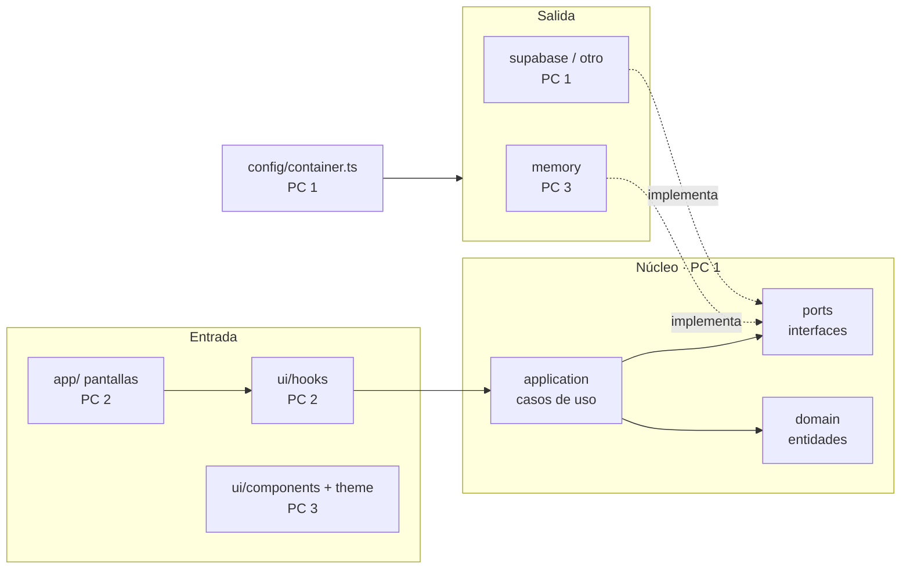

# 🖥️ Reparto por PCs y fases — Kampus

Volver a [[Inicio]] · Ver [[Esquema del proyecto]] · [[Arquitectura y stack]]

## Equipos y herramientas de IA

| PC                  | Agente de IA            | Área                                                           | Carga aprox. | Persona |
| ------------------- | ----------------------- | -------------------------------------------------------------- | ------------ | ------- |
| **PC 1** (nosotros) | **Claude Code + Codex** | Arquitectura, núcleo, backend completo, integración y revisión |              | Izan    |
| **PC 2**            | OpenCode                | Pantallas de la app (`src/app/`)                               |              |         |
| **PC 3**            | OpenCode                | Componentes, tema, accesibilidad y datos de prueba             |              |         |
| **PC 4**            | OpenCode                | Diseño en Figma, panel web y tests E2E                         |              |         |

## Qué hace cada PC (para explicarlo al equipo)

### 🧠 PC 1 — Líder técnico · Izan · Claude Code + Codex
**Rol:** el arquitecto y el "cerebro" del proyecto. Decide cómo encaja todo y se asegura de que funcione junto.
- **Define los contratos:** qué datos existen (alumno, dossier, registro diario…) y qué operaciones hay (registrar horas, validar un día…). Los demás construyen sobre eso.
- **Monta el backend:** Supabase, tablas, permisos por rol (qué ve un alumno, un profe o un admin) y la conexión con la app.
- **Integra y revisa:** toda PR pasa por PC 1 antes de entrar en `main`. Vigila que nadie rompa la arquitectura.
- **Coordina:** reparte tareas, mantiene el vault y el tablero al día.
- **Entrega:** "la app funciona con datos reales y de forma segura".

### 📱 PC 2 — Pantallas de la app · OpenCode
**Rol:** lo que el usuario ve y toca. Convierte los diseños en pantallas reales.
- Login, navegación por rol (pestañas distintas para alumno, profe y admin).
- Pantallas del MVP: panel "Hoy", registro diario, calendario, tareas, dossier y vista del profe.
- Conecta cada pantalla con los casos de uso que prepara PC 1 (no habla con la base de datos directamente).
- **Entrega:** "cada función del MVP tiene su pantalla y se puede usar de principio a fin".

### 🧩 PC 3 — Piezas visuales y datos de prueba · OpenCode
**Rol:** la caja de herramientas visual. Fabrica las piezas que PC 2 usa para montar pantallas.
- Componentes del sistema de diseño monocromo: botones, inputs, tarjetas, chips de estado, celdas de calendario.
- Tema (colores, Inter, claro/oscuro) y accesibilidad (contraste, tamaño de texto, lector de pantalla).
- Datos de prueba realistas para que la app se pueda usar y enseñar sin depender de Supabase.
- **Entrega:** "todas las pantallas se ven iguales, cuidadas y accesibles".

### 🎨 PC 4 — Diseño, web y calidad · OpenCode
**Rol:** el que dibuja antes y comprueba después.
- **Antes de programar:** mockups en Figma de cada pantalla con el sistema de diseño.
- **Panel web** de administración (Next.js + Vercel) para gestionar usuarios, centros y periodos.
- **Calidad:** tests E2E que prueban la app como un usuario real y revisión de experiencia de uso.
- **Final:** página de presentación, vídeo y demo.
- **Entrega:** "se ve bien antes de construirse y funciona bien después".

### Cómo trabajan juntos
`PC 4 diseña` → `PC 1 define datos y operaciones` → `PC 3 prepara piezas y datos de prueba` + `PC 2 monta la pantalla` → `PC 4 prueba` → `PC 1 revisa e integra`

**Por qué así:** PC 1 se queda con todo lo que define el contrato y lo que es difícil de deshacer: dominio, puertos, base de datos, seguridad y la integración. Los PCs 2-4 trabajan sobre contratos ya cerrados, con tareas acotadas que OpenCode resuelve bien.

### Dentro de PC 1: Claude vs Codex
- **Claude Code:** diseño de arquitectura, puertos y casos de uso, esquema de BD y RLS, revisión de todas las PR, documentación del vault.
- **Codex:** implementación en paralelo de adaptadores reales, Edge Functions, tests unitarios, CI y tareas mecánicas (migraciones, refactors).
- Nunca los dos en la misma rama a la vez: Claude diseña y abre el puerto → Codex implementa el adaptador en otra rama.

## Áreas y carpetas

| PC | Es dueño de | No toca |
|---|---|---|
| **PC 1** | `src/core/`, `src/config/`, `src/infrastructure/` (salvo `memory/`), BD, RLS, Edge Functions, `.github/`, `eslint.config.js`, `package.json` | — (revisa todo) |
| **PC 2** | `src/app/`, `src/ui/hooks/` | `core/`, `config/`, `infrastructure/` |
| **PC 3** | `src/ui/components/`, `src/ui/theme/`, `src/infrastructure/memory/` | `core/`, `config/`, resto de `infrastructure/` |
| **PC 4** | Figma, repo/carpeta del panel web, `e2e/` | código de la app móvil |

Las mismas reglas están en `AGENTS.md` del repo, así OpenCode, Codex y Claude las siguen automáticamente.

## Arquitectura técnica (quién hace cada capa)

## Flujo para cada módulo nuevo (ej. notas, faltas, horario)

1. **PC 1 (Claude):** entidad + puerto + casos de uso → PR y fusión. Ese puerto es el contrato.
2. En paralelo:
   - **PC 3:** adaptador en memoria con datos de prueba realistas.
   - **PC 2:** pantallas contra el adaptador en memoria.
   - **PC 1 (Codex):** tabla, RLS y adaptador real.
   - **PC 4:** mockup antes; tests E2E después.
3. **PC 1:** registra el adaptador real en `container.ts`, revisa e integra.

## Reparto por fases

| Fase | PC 1 · Claude + Codex | PC 2 · Pantallas | PC 3 · UI base y datos de prueba | PC 4 · Diseño, web y QA |
|---|---|---|---|---|
| **Análisis** (ahora) | Analizar el SBIT completo: módulos, perfiles, entidades, requisitos → redactar [[Requisitos funcionales]] | Flujos de usuario por perfil | Inventario de datos de ejemplo | Referencias visuales |
| **Diseño** | Puertos de todos los módulos, esquema de BD (ERD), RLS, decidir backend | Mapa de navegación por rol | Componentes base y tema | Mockups Figma y guía de estilo |
| **Sprint 1** · Auth y navegación | Auth completa (casos de uso + adaptador real + perfiles), tests, revisión | Login y pestañas por rol | Componentes de formulario, adaptador memoria de auth | Componentes en Figma, primeros E2E |
| **Sprint 2** · Módulos MVP | Puertos, casos de uso, tablas, RLS y adaptadores de todo el MVP; integración | Pantallas del MVP | Adaptadores en memoria del MVP, accesibilidad | Tests E2E del MVP, revisión UX |
| **Sprint 3** · Secundarias y web | Notificaciones, Edge Functions, módulos secundarios, API del panel web | Pantallas secundarias | Estados vacíos, errores y carga | Panel web de administración (Vercel) |
| **Sprint 4** · Pulido | Rendimiento, auditoría de seguridad, datos de demo, revisión final de capas | Animaciones y detalles | Auditoría de accesibilidad | Página de presentación |
| **Entrega** | Documentación técnica, despliegue, APK, coordinación de la demo | Demo en Expo Go | Capturas de la app | Vídeo y presentación |

## Normas de trabajo entre PCs
- Rama por tarea: `feature/pcN-descripcion` (ej. `feature/pc2-login`).
- Toda PR la revisa PC 1 antes de fusionar; el CI tiene que estar en verde.
- `git pull` al empezar; PR pequeñas y frecuentes.
- Cada PC apunta su avance en [[Tablero de tareas]].
