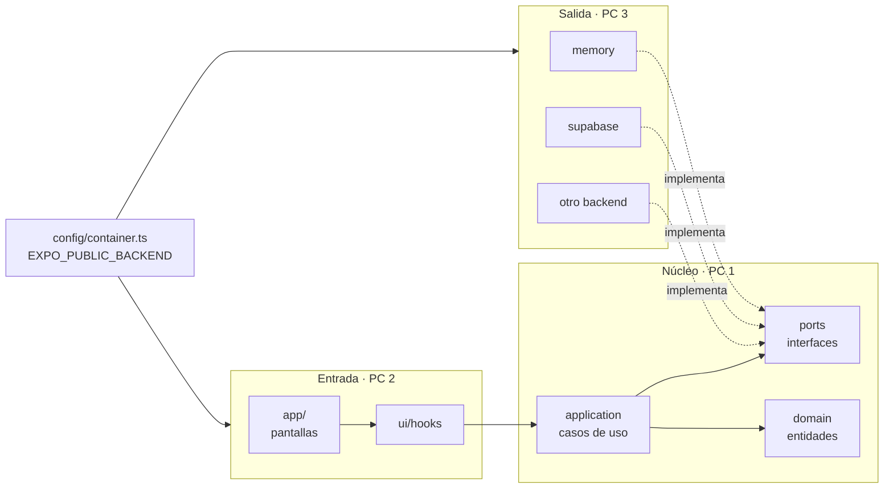

# 🖥️ Reparto por PCs y fases — Kampus

Volver a [[Inicio]] · Ver [[Esquema del proyecto]] · [[Arquitectura y stack]]

## Áreas de cada PC

Cada PC es dueño de una capa de la arquitectura hexagonal. Así nadie pisa archivos de otro y los conflictos de Git son mínimos.

| PC | Área | Carpetas / herramientas | Persona |
|---|---|---|---|
| **PC 1** | Núcleo y arquitectura | `src/core/`, `src/config/`, CI, revisión de PRs | |
| **PC 2** | App móvil | `src/app/`, `src/ui/` | |
| **PC 3** | Datos y backend | `src/infrastructure/`, base de datos, RLS, Edge Functions | |
| **PC 4** | Diseño, web y QA | Figma, panel web (Next.js + Vercel), tests E2E | |

## Arquitectura técnica (cómo viaja una petición)

- `core/` es TypeScript puro: ni React, ni Expo, ni Supabase (lo impide ESLint).
- `app/` y `ui/` nunca importan adaptadores: usan casos de uso y `container`.
- `container.ts` es el único punto que decide el backend.

## Flujo para cada módulo nuevo (ej. notas, faltas, horario)

1. **PC 1** define la entidad (`domain/`), el puerto (`ports/`) y los casos de uso → PR.
2. En paralelo, tras fusionar el puerto:
   - **PC 2** hace las pantallas contra el adaptador **en memoria**.
   - **PC 3** hace la tabla, las reglas RLS y el adaptador **real**.
   - **PC 4** prepara el mockup (antes) y los tests E2E (después).
3. **PC 1** registra el adaptador real en `container.ts` y revisa.

## Reparto por fases

| Fase | PC 1 · Núcleo | PC 2 · App móvil | PC 3 · Datos y backend | PC 4 · Diseño, web y QA |
|---|---|---|---|---|
| **Análisis** (ahora) | Entidades y casos de uso del SBIT | Perfiles y flujos de usuario | Inventario de datos que maneja | Referencias visuales y requisitos no funcionales |
| **Diseño** | Puertos de cada módulo | Navegación por rol y componentes base | Esquema de BD (ERD), decidir backend | Mockups Figma y guía de estilo |
| **Sprint 1** · Auth y navegación | Casos de uso de sesión + tests unitarios | Login y pestañas por rol | Adaptador auth real + tabla de perfiles | Componentes del sistema de diseño |
| **Sprint 2** · Módulos MVP | Casos de uso MVP, revisión de PRs | Pantallas del MVP | Tablas, RLS y adaptadores MVP | Tests E2E y revisión UX |
| **Sprint 3** · Secundarias y web | Notificaciones y casos secundarios | Pantallas secundarias | Edge Functions y notificaciones | Panel web de administración (Vercel) |
| **Sprint 4** · Pulido | Rendimiento y revisión de capas | Accesibilidad y animaciones | Datos de demo y auditoría de seguridad | Página de presentación |
| **Entrega** | Documentación técnica | APK y demo en Expo Go | Despliegue y copia de la BD | Vídeo y presentación |

## Normas de trabajo entre PCs
- Rama por tarea: `feature/pcN-descripcion` (ej. `feature/pc2-login`).
- PR siempre revisada por otro PC; PC 1 revisa todo lo que toque `core/` o `config/`.
- `git pull` al empezar el día; PR pequeñas y frecuentes.
- Cada PC apunta su avance en [[Tablero de tareas]].
